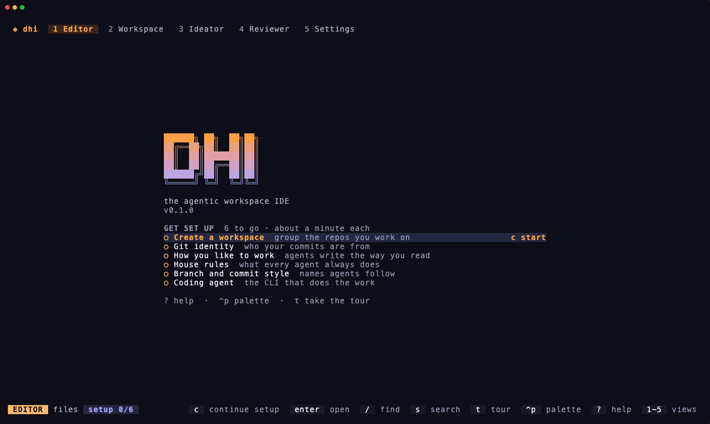
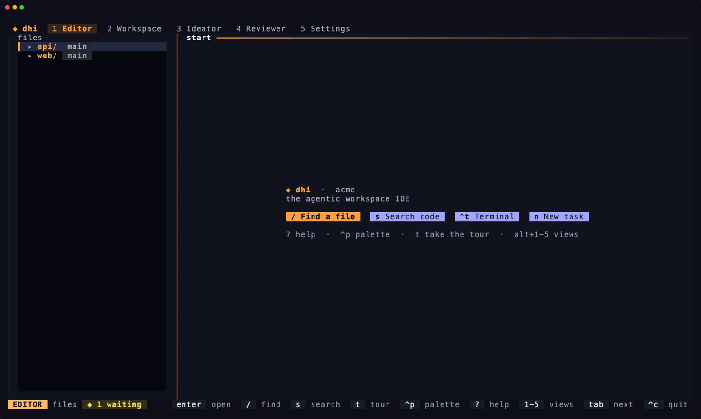
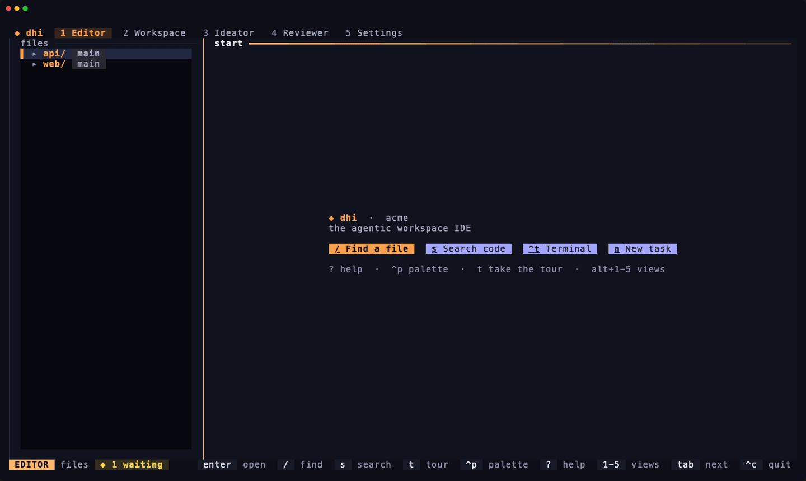

<div align="center">

# ◆ DHI

**The agentic workspace IDE — in your terminal.**

A keyboard-first IDE where you and a crew of AI agents share one workspace:
a board, channels, an editor, a review screen, all in one terminal window.

[](https://github.com/drjzlyan/dhi/actions/workflows/ci.yml)
[](https://github.com/drjzlyan/dhi/releases)
[](go.mod)
[](LICENSE)



</div>

## Why DHI

You ask agents for work in one window, review what they did in another, and
track it all somewhere else. DHI puts it in one place, inside the editor you
already work in:

- **A team, not a chat box.** Agents have names, roles, skills and memory.
  Assign them cards on a board, @-mention them in channels, or pair with
  one in a buffer.
- **Review that feels like a real review.** Every change lands in its own
  git worktree. You get a three-column diff, word-level highlights, agent
  suggestions you accept or dismiss, and one GitHub review sent as you.
- **Many repos, one workspace.** Navigate, search and replace across every
  member repo at once; changes that span services stay linked.
- **Your keyboard, your rules.** Vim-style editing, a command palette for
  everything, and every key shown where you need it. The mouse works too.
- **Your tools, your config.** DHI uses the git, language servers, ripgrep,
  GitHub CLI and coding agents already on your machine, with your shell
  environment, `~/.gitconfig`, SSH keys and logins, as your terminal does.
  A missing tool is offered with your package manager's exact command, and
  it runs only when you say yes.
- **Fits any window.** Every screen adapts from a narrow split to an
  ultrawide monitor and is tested at each size.

## A look around

Recorded from the real app with [VHS](https://github.com/charmbracelet/vhs) (`make record`).

**Every view.** The Editor opens first. Then the Workspace board and inbox, and the Reviewer's diff.



**The Editor.** Vim-style editing, split panes, find-a-file and a real terminal, one tab per repo.


**Settings, live.** The theme changes as you cycle it; values save for this workspace or everywhere.



MP4 versions: [onboarding](docs/assets/recordings/onboarding.mp4) · [views](docs/assets/recordings/views.mp4) ·
[editor](docs/assets/recordings/editor.mp4) · [settings](docs/assets/recordings/settings.mp4).

## Install

**Script** (macOS and Linux):

```sh
curl -fsSL https://github.com/drjzlyan/dhi/releases/latest/download/install.sh | sh
```

The installer picks the build for your machine, **verifies its SHA-256** (and
its cosign signature when `cosign` is installed), and puts `dhi` in
`~/.local/bin` without sudo.

- Pin a version: `curl -fsSL …/install.sh | DHI_VERSION=0.2.0 sh`.
- Choose the folder: `… | DHI_INSTALL_DIR=/your/bin sh`.

**Homebrew** (macOS and Linux):

```sh
brew install drjzlyan/tap/dhi
```

The formula installs the same checksummed binary from the GitHub release.
Use one method, not both: a copy in `~/.local/bin` earlier on your `PATH`
hides the Homebrew one (`rm ~/.local/bin/dhi` if you switch to Homebrew).

**Platforms:** macOS (Apple silicon and Intel, macOS 12+) and Linux
(x86_64 and arm64). Others are refused at install time with the reason.

<details>
<summary>Build from source</summary>

```sh
git clone https://github.com/drjzlyan/dhi && cd dhi
go run ./cmd/dhi      # Go 1.26+
make verify           # fmt + vet + race tests
```
</details>

### Updating

```sh
# installed with the script: re-run it (it replaces the binary in place)
curl -fsSL https://github.com/drjzlyan/dhi/releases/latest/download/install.sh | sh

# installed with Homebrew
brew update && brew upgrade dhi

dhi version   # check what you have
```

Updating never touches your settings (`~/.config/dhi`) or workspaces. Restart any running `dhi` to pick up the new
version. To go back to an older release, re-run the script with
`DHI_VERSION=<version>`.

## First run

```sh
cd your-project && dhi
```

1. **Your tools.** DHI reads your login shell's environment, so tools from
   Homebrew, nvm, asdf or mise are found. Nothing is downloaded at launch.
   When a feature needs a missing tool (a language server, ripgrep), a card
   shows the command, for example `brew install gopls`. Press `y` and it
   runs in a terminal tab you can watch. Earlier versions kept a toolchain
   in `~/.local/share/dhi/toolchain`; DHI offers to delete it, and does so
   only on yes.
2. **Setup.** A short wizard covers:
   - the workspace;
   - your git identity;
   - team conventions (commit format, branch names, co-author);
   - which coding agent to use;
   - a starter team;
   - the tools your bots work in (Atlassian, Slack, Zoom, Linear, Notion, GitHub).

   Skip anything. Change any step later from the start page or
   Settings → SETUP; each step opens with what you have now.
3. **Learn by doing.** `ctrl+p` → *Tutorial* runs short lessons under the
   live UI; each step waits for you to do the real action.

Agents run on the coding CLI you already use: **Claude Code**, **Codex**,
**Cursor Agent**, **GitHub Copilot CLI**, **opencode** or **Antigravity**.
DHI detects it, installs most of them for you after asking, and keeps every
agent inside the workspace's tools, scopes and approvals.

## Skills and integrations

DHI uses the formats every coding agent reads, so nothing is DHI-only:

- **Skills** are [Agent Skills](https://agentskills.io) (`<name>/SKILL.md`). Install one from a
  GitHub URL, `owner/repo`, any git URL or a folder in Settings → SKILLS; skills you already have
  in `~/.agents/skills` or a repo's `.claude/skills` show up too.
- **MCP servers** use the standard `mcpServers` JSON (`.dhi/mcp.json`). Add the vendors' official
  plugins from Settings → INTEGRATIONS, a server by URL, or paste a config snippet.
- **Sign in, nothing else.** For servers that use OAuth (Atlassian, Slack, Linear, Notion, …) DHI
  opens the vendor's login page the first time a bot needs it. No app to register, no API key.
- **Who gets what.** Every install ends by choosing the bots: DHI recommends the ones whose role
  fits (and says why), or give it to all bots, including ones you add later.
- Installs pin the commit and show every script and command first; the scripts of a skill DHI
  installs stay off until you allow them.

## Keys

| Key | Does |
|---|---|
| `1`–`5`, `tab` | switch views: Editor · Workspace · Ideator · Reviewer · Settings |
| `alt+1`–`5` (`⌥1`–`5`) | switch views from anywhere, even while typing |
| `[` `]` | switch sections inside a view |
| `ctrl+p` | command palette: search every action |
| `?` | help for where you are; `/` searches it |
| `n` | new task / session / review, depending on the view |
| `s`, `ctrl+r` | search the workspace; toggle regex |
| `ctrl+w v` | split the editor |
| `ctrl+t` | terminal drawer — vim, htop and friends run full screen |
| `cmd+v` / `ctrl+shift+v` | paste into the focused field, buffer or terminal (secret fields stay masked) |
| `y` (buffer), `Y` (chat, trace) | copy to the system clipboard |
| `alt+←/→`, `ctrl+w`, `ctrl+u` | move by word, delete a word, clear to the start, in any text field |
| `ctrl+c` | quit |

On a Mac, turn on **Option as Meta** in your terminal for every `alt` key (Terminal.app: Settings →
Profiles → Keyboard; iTerm2: Profiles → Keys → Left Option key: Esc+). Without it, `⌥1`–`⌥5` still
switch views. To select text with the mouse, `ctrl+p` → *Select text with the mouse*.

Remap any key in `config.toml` (`[keys] "ctrl+k" = "ctrl+p"`); hints and help follow your keys.
`dhi version` prints the build; `dhi doctor` diagnoses an install.

## Docs

| | |
|---|---|
| [Product overview](docs/product.md) | vision, personas, the five views |
| [Architecture](docs/architecture.md) | modules and dependency rules |
| [Testing](docs/testing.md) | test pyramid, golden snapshots, the layout contract |
| [Decisions](docs/adr/) | architecture decision records |
| [Features](docs/features/) | one spec per feature, with acceptance criteria |
| [Roadmap](ROADMAP.md) | milestones, done and planned |

## Contributing

Bug reports, ideas and pull requests are welcome. See
[CONTRIBUTING.md](CONTRIBUTING.md) to get set up (`make verify` is the bar),
and please read the [Code of Conduct](CODE_OF_CONDUCT.md). To report a
security issue privately, follow [SECURITY.md](SECURITY.md).

## License

[MIT](LICENSE)
